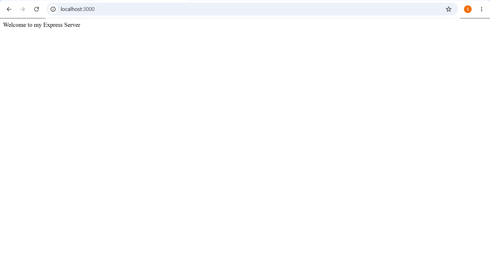
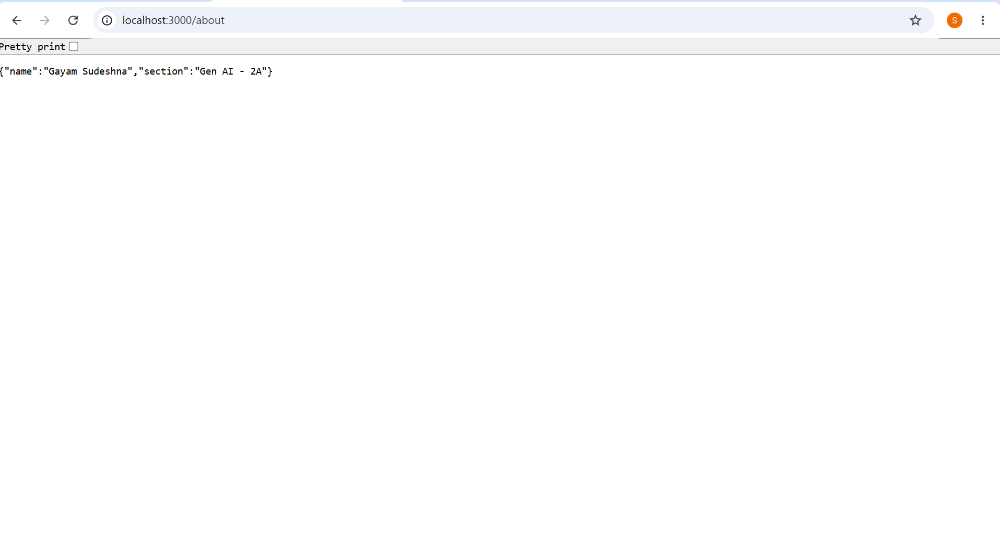
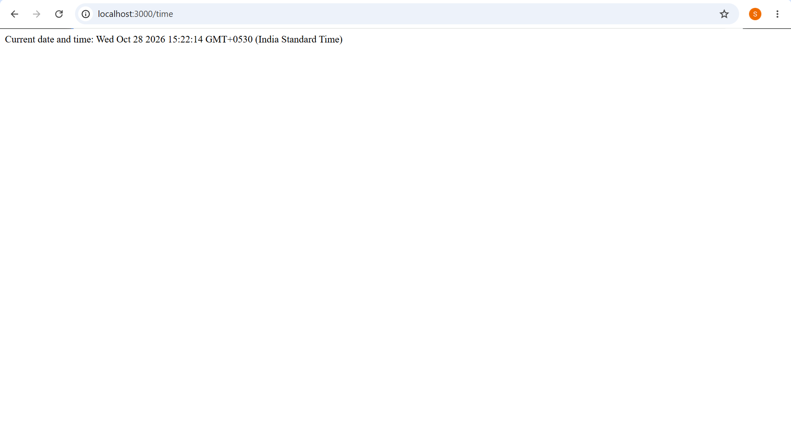

# Lab 1: Node.js and Express Server

## Student Details
- Name: Gayam Sudeshna
- Registration Number: 252U1R9039
- Section: GEN AI - 2A
- Course: Backend Development Fundamentals

## Live Link
Deployment pending.

## Objective
The objective of this lab is to create a Node.js
project and develop a web server using the built-in
HTTP module and Express.js.

## Technologies Used
- Node.js
- Express.js
- JavaScript
- Visual Studio Code

## How to Run

Requirements:
- Node.js
- npm

Install dependencies:

    npm install

Run the basic HTTP server:

    node http-server.js

Run the Express server:

    node server.js

Open http://localhost:3000 in a browser.

Only run one server at a time because both use
port 3000.

Environment variables:
No environment variables are required.

## API Endpoints

| Method | Path | Description | Status |
|--------|------|-------------|--------|
| GET | / | Displays welcome message | 200 |
| GET | /about | Returns name and section as JSON | 200 |
| GET | /time | Displays current date and time | 200 |
| GET | /anything | Displays 404 message | 404 |

## Screenshots

### Home Route

### About Route

### Time Route

### 404 Error

## Package.json Explanation

- name: Name of the project.
- version: Current project version.
- description: Short information about the project.
- main: Main entry file of the project.
- scripts: Commands used to run or test the project.
- keywords: Words describing the project.
- author: Name of the developer.
- license: License information.
- dependencies: Packages required by the project.

## Viva Questions

### 1. Difference between package.json and node_modules

package.json stores project information and
dependency details.

node_modules contains the installed packages
required by the project.

### 2. What does app.listen() do?

app.listen() starts the Express server and makes
it listen for requests on a specified port.

### 3. What are request and response?

Request (req) contains information sent by
the client to the server.

Response (res) is used to send information
from the server back to the client.

## Problems Faced and Solutions

1. Initially, I needed to organize the project
   folders correctly.
   Solution: I created a separate lab-01 folder.

2. I had difficulty saving screenshots.
   Solution: I created a screenshots folder and
   copied the images into it.

3. My name did not appear in the About route.
   Solution: I updated the details in server.js
   and restarted the server.

## Conclusion

In this lab, I learned how to initialize a Node.js
project, install Express.js, create HTTP and Express
servers, define routes, return JSON responses,
and handle 404 errors.
