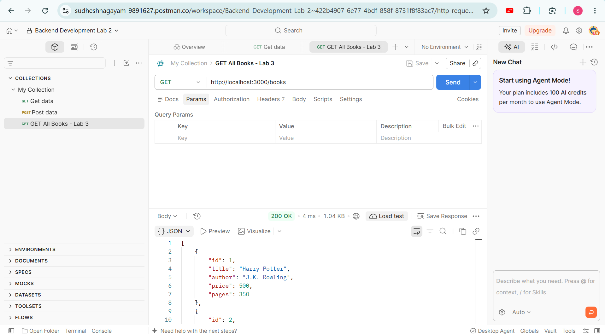
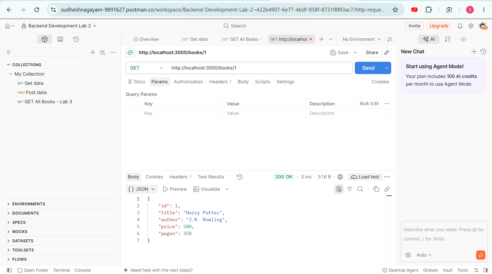
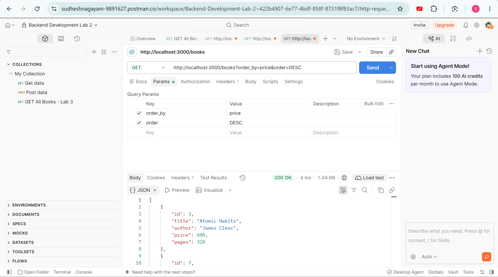
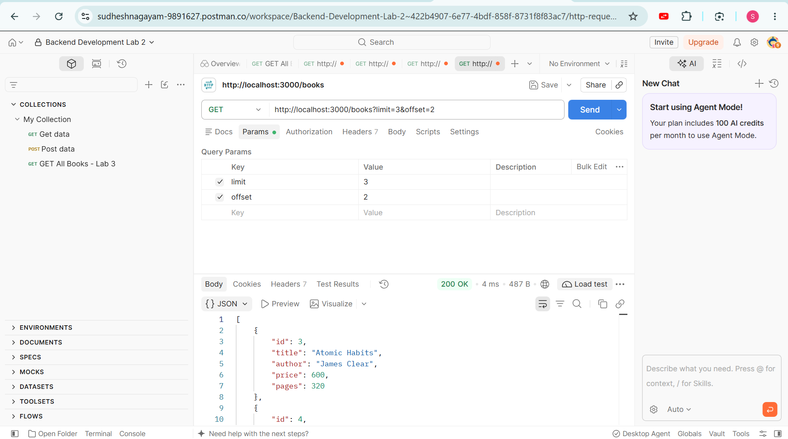
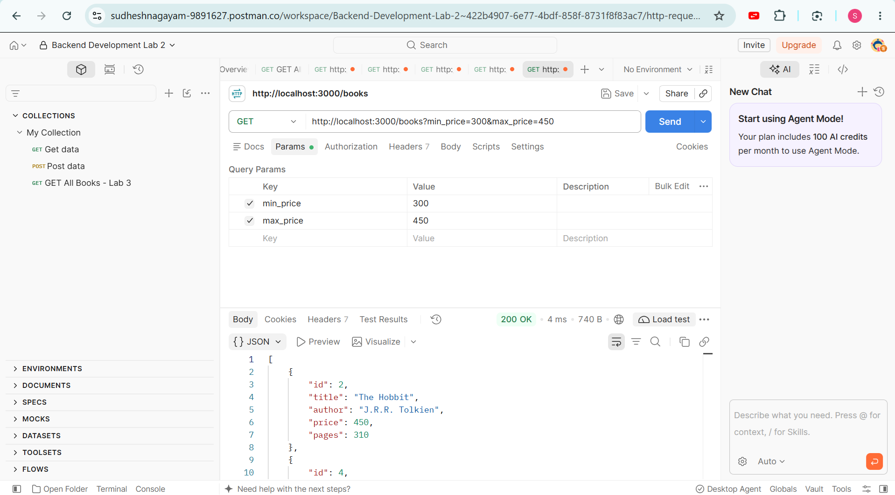
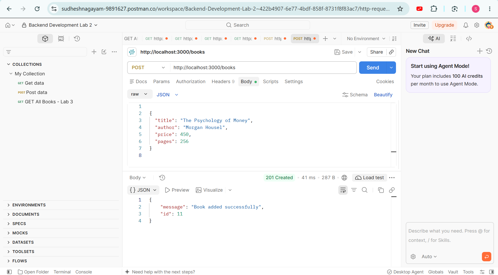
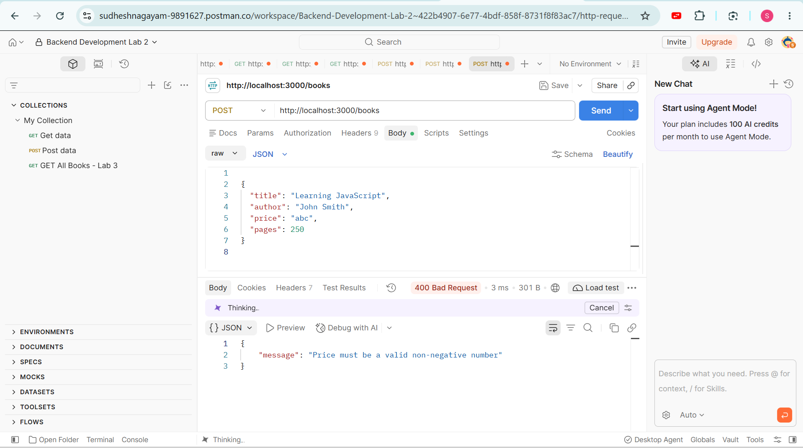
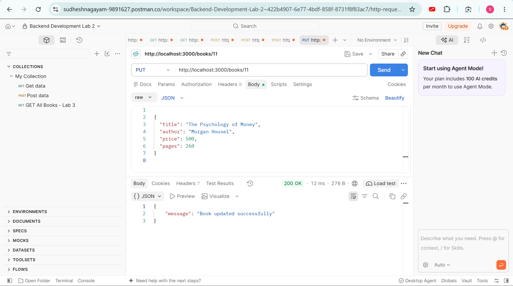
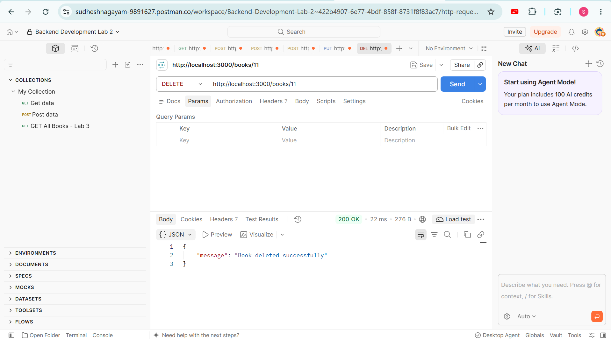
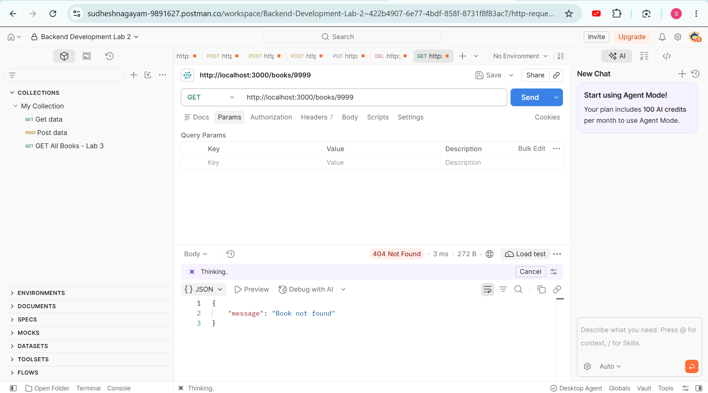

# Lab 3: REST API, Query Parameters, Validation, Debugging

**Name:** Gayam Sudeshna  
**Registration Number:** 252U1R9039  
**Section:** CSE - GEN AI - 2A

## Live Deployment

The Lab 3 Book Management REST API is successfully deployed on Render.

**Deployed Link:** https://backend-development-lab-3.onrender.com/books

**Hosting Platform:** Render

The deployed API displays the book records in JSON format. It also supports searching, sorting, pagination, filtering, and CRUD operations.

## Objective

The objective of this lab is to improve the Book Management REST API developed in Lab 2. This lab includes searching, sorting, pagination, price filtering, input validation, and proper HTTP status codes.

## Technologies Used

- Node.js
- Express.js
- SQLite3
- Postman
- Visual Studio Code

## How to Run

1. Open the project in VS Code.
2. Open the terminal.
3. Navigate to the Lab 3 folder:

   `cd lab-03`

4. Install dependencies:

   `npm install`

5. Start the server:

   `node server.js`

6. Open the API:

   `http://localhost:3000/books`

The server uses port 3000 by default. The optional `PORT` environment variable can be used to change it.

## API Endpoints

| Method | Endpoint | Description |
|---|---|---|
| GET | `/books` | Get all books |
| GET | `/books/:id` | Get a book by ID |
| GET | `/books?search_q=Harry` | Search books by title |
| GET | `/books?order_by=price&order=DESC` | Sort books by price |
| GET | `/books?limit=3&offset=2` | Display books using pagination |
| GET | `/books?min_price=300&max_price=450` | Filter books by price |
| POST | `/books` | Add a new book |
| PUT | `/books/:id` | Update an existing book |
| DELETE | `/books/:id` | Delete a book |

## Screenshots

### 1. GET All Books

### 2. GET Book by ID

### 3. Search Books

### 4. Sort Books

### 5. Pagination

### 6. Price Filtering

### 7. POST Add Book

### 8. POST Validation Error

### 9. PUT Update Book

### 10. DELETE Book

### 11. GET Book Not Found

## HTTP Status Codes

| Status Code | Meaning |
|---|---|
| 200 | Request successful |
| 201 | Book created successfully |
| 400 | Invalid input |
| 404 | Book not found |
| 500 | Server or database error |

## Debugging Notes

Common errors reviewed in this lab:

- **EADDRINUSE:** Occurs when the selected server port is already in use.
- **Wrong import path:** Fixed by checking the correct file or module path.
- **Database table error:** Checked that the SQLite table name is `book`.
- **Missing await:** Reviewed the importance of waiting for asynchronous operations when using promises.

## Conclusion

In this lab, I extended the Book Management REST API by adding search, sorting, pagination, price filtering, and input validation. I tested the API using Postman and checked both successful and error responses.
